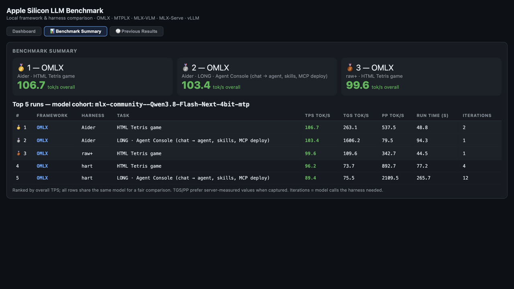

# benchtest

**Local LLM benchmarking for Apple Silicon.** Compare how the same model performs
across the major local inference frameworks (OMLX, MTPLX, MLX-VLM, MLX-Serve) and
across harnesses (raw API, raw+ streaming, and the agent CLIs pi / opencode /
aider / hart) — with real throughput (TPS/TGS/PP), latency, and the actual artifact
each cell produces, linked for your own review.

Everything runs **locally** against models already on your machine. No cloud, no
accounts, no telemetry. The backend is **pure Python standard library** — there is
nothing to `pip install`.

---



## What it measures

For every **framework × harness** cell on a chosen task, benchtest records:

| Metric | Meaning |
|--------|---------|
| **TPS** | Overall throughput — completion tokens / total wall time |
| **TGS** | Decode speed — tokens generated per second (server-measured where the framework exposes it) |
| **PP** | Prefill speed — prompt tokens processed per second |
| **Run time** | End-to-end wall time for the cell |
| **Iter** | Model requests the harness made (agent loops, raw+ continuations; raw = 1) |
| **Tokens** | Completion tokens produced |
| **Output** | The actual artifact (HTML/text), saved and viewable |

The dashboard shows a live activity feed, a per-cell streaming tail, a comparison
chart (TPS/TGS/PP per framework across harnesses), and a "winning combo" (best usable
result, soonest). Every completed run is saved to `runs/*.json` for later comparison.

pi and opencode run in their structured JSON event modes (`--mode json` /
`--format json`) — the same event stream their TUIs render — so the Live
Harness Activity feed shows real agent narration: tool calls with target
paths, thinking phases, chat replies, and per-step token counts. Their token totals are the
model's exact output tokens (not word-count estimates), and sibling files an
agent writes next to its HTML (e.g. `app.js`) are inlined into the collected
artifact so the Artifacts links show what was actually built.

---

## Headline results (Apple M5 Max, 128 GB)

Median decode speed, tokens/s, from the frozen datasets in [`results/`](results/)
(3 tasks × up to 4 frameworks × 6 harnesses; agent rows use server-measured TGS):

| Framework | Qwen3.8-27B raw / agent | Flash-Next raw / agent | Flash-Next gain |
|---|---|---|---|
| **MTPLX** | 51.9 / 46.6 | **89.4 / 84.9** | **~1.7×** |
| **OMLX** | 53.0 / 51.0 | **88.8 / 87.6** | **~1.7×** |
| **MLX-Serve** | 52.2 / 49.6 | *does not fit (needs ~112.5 GB)* | — |
| **MLX-VLM** | 35.8 / 34.9 | 38.7 / 39.0 | ~none — its runtime doesn't exploit the MTP build |

Reliability: 72/72 cells on the Qwen set; 53/54 on Flash-Next (one honest
thinking-cap error row). The finding that matters: **Flash-Next is a ~1.7×
win on MTPLX and OMLX but a wash on MLX-VLM** — model choice alone doesn't
decide speed; the framework does. Interactive charts: the [benchtest Results Space](https://huggingface.co/spaces/mlxbencher/benchtest-results)
(dataset: [mlxbencher/benchtest-results](https://huggingface.co/datasets/mlxbencher/benchtest-results)).

**Positioning**: raw-performance Apple-Silicon benchmarks exist ([Anubis OSS](https://github.com/Anubis-ops/anubis),
[apple-silicon-llm-bench](https://github.com/john-rocky/apple-silicon-llm-bench));
agent-harness leaderboards exist for cloud APIs. benchtest is the cross:
**local serving frameworks × real agent harnesses × real build artifacts,
on one Mac** — the "which framework should serve this model, and does the
harness change the outcome?" tool.

**The task suite** — deliberately small, each task a different kind of work:
`tetris` (interactive game logic), `codereview` (find the planted defects in a
sample module), `markdown` (a CommonMark-subset compiler with spec tests),
`agentconsole` (chat → tool-calling agent with skills + MCP deploy), plus
**✏️ Custom prompt** for anything else — its template documents what models can
and cannot reach in this environment. Every done cell also gets a
**reliability QA score** (`qa.py`): deterministic artifact checks — delivered,
substantial, structurally complete, self-test result, untruncated — with the
breakdown one hover away. The judgment stays human; the score only measures
whether the delivery is sound.

Then in the browser: pick your frameworks and harnesses, choose a task (or edit the
prompt), and hit **▶ Run Benchmark**.

> **First run tip:** the *Model per Framework* panel lists every model on your machine
> (HF cache + MTPLX store) with a live compatibility verdict (**ready / tight /
> too-large / unknown**) based on your current free RAM. Models a framework can't serve
> are greyed out (e.g. MTPLX-only models for OMLX/MLX-VLM/MLX-Serve). Pick a model and
> it's written straight into `config.json`.

---

## Roadmap

**V1 (current release) — the MLX-native frameworks, on purpose.** OMLX,
MTPLX, MLX-VLM, and MLX-Serve × six harnesses (raw, raw+, pi, opencode,
aider, hart) on the built-in task suite, with model discovery + RAM-fit
validation, per-cell metrics, reliability QA, and frozen results for
Qwen3.8-27B and Flash-Next. vLLM ships wired for standard HF repos with
a reference model (Gemma) — the one framework where the Qwen MTP builds
don't run yet.

**V2 — widening the matrix.**
- **Ollama and llama.cpp (llama-server)** as first-class frameworks
- **vLLM with the Qwen MTP builds** once upstream vLLM supports them
  (vote in the Discussions to show demand)
- **A public cross-chip results set (M1–M5)** built from community runs —
  see [Contributing results](#contributing-results--run-it-on-your-mac);
  smaller-RAM machines stay first-class via fit validation

**Future releases.** More agent harnesses as the ecosystem grows, and
richer aggregate statistics across community submissions.

## Contributing results — run it on your Mac

The published numbers are one machine; yours will differ, and that's the
point. Run benchtest on your Mac (16 / 32 / 64 / 128 GB — the model
picker only offers models that fit your RAM), then open a PR against
[`community-results/`](community-results/) adding your run JSONs under a
folder named `<github-user>-<machine>` (e.g. `jdoe-m4-16gb/`) with a
short README (chip, RAM, models, frameworks). Match the manifest format
in [`results/`](results/). The QA score keeps entries comparable:
deterministic checks, raw JSON for anyone to re-analyze.

## Shape V2 — vote on what we benchmark next

V2's framework list (llama.cpp, Ollama, LM Studio, vLLM-for-Qwen-MTP) is
the starting ballot, not the limit. **Voting is open** in the pinned
**"Vote: shape V2"** GitHub Discussion:

- 🗳️ **Vote by reaction**: each candidate framework / model family /
  harness is its own comment in the Discussion — add a 👍 to everything
  you want benchmarked. One reaction per comment = one vote; the tally
  is the comment's reaction count.
- ✍️ **Write-ins welcome**: don't see your pick? Add it as a new comment
  in the right category (framework / model / harness) and others can
  vote on it too.
- 📊 **Tallies steer the roadmap**: we pick up the top vote-getters for
  each V2 milestone, in order, and edit the Roadmap above when a pick
  moves into development.

Anything with an OpenAI-compatible `/v1` endpoint and a CLI-launchable
server is eligible; the bar for inclusion is that a community member can
reproduce the numbers on their own machine.

**Already have one framework (e.g. OMLX) and a model downloaded?**
You're three commands from a run — no config editing needed on the
default path: `./install.sh` → `python3 server.py` → open
`http://localhost:7090`, pick your model in the dropdown, tick tasks,
Run. (Editing `config.json` is only for custom start commands, ports, or
model-set presets.)

## Quick start

```bash
# 1. Get the code
git clone https://github.com/gitmlxbench/benchtest.git
cd benchtest

# 2. Check prerequisites + seed config.json
./install.sh

# 3. Edit config.json to match your machine (models, ports, start commands)
$EDITOR config.json

# 4. Start the server
python3 server.py            # or: make run
#    ➜ Open http://localhost:7090
```

## Prerequisites

- **Apple Silicon Mac** (M1 or later) with a recent **Python 3.10+** on your `PATH`.
- The **framework CLIs** you want to benchmark (install only what you need):

| Framework | What it is | Install | Repo / site |
|-----------|-----------|---------|-------------|
| **OMLX** | macOS app + `omlx` CLI | download the app from the site | [omlx.ai](https://omlx.ai) · [github.com/jundot/omlx](https://github.com/jundot/omlx) |
| **MTPLX** | MTP speculative decoding for Qwen3-Next | `brew tap youssofal/mtplx && brew install mtplx` | [github.com/youssofal/MTPLX](https://github.com/youssofal/MTPLX) |
| **MLX-Serve** | OpenAI/Anthropic-compatible server | `brew tap ddalcu/mlx-serve && brew install mlx-serve` | [github.com/ddalcu/mlx-serve](https://github.com/ddalcu/mlx-serve) |
| **MLX-VLM** | VLM / omni inference via `mlx_vlm` | `pip install mlx-vlm` (into the `python3` on your `PATH`) | [github.com/Blaizzy/mlx-vlm](https://github.com/Blaizzy/mlx-vlm) |

- **Agent harness CLIs** (only for the agent rows) — community tools you install yourself:

| Harness | Install | Repo / site |
|---------|---------|-------------|
| **pi** | `npm install -g @earendil-works/pi-coding-agent` | [github.com/earendil-works/pi](https://github.com/earendil-works/pi) |
| **opencode** | `npm install -g opencode-ai` | [opencode.ai](https://opencode.ai) · [github.com/anomalyco/opencode](https://github.com/anomalyco/opencode) |
| **aider** | `python3 -m pip install aider-chat` | [aider.chat](https://aider.chat) |
| **hart** | *bundled in this repo — no install* | [`hart/`](hart/) |

- **Models** — already on your machine (benchtest auto-discovers them):
  - OMLX / MLX-VLM / MLX-Serve read from your Hugging Face cache
    (`~/.cache/huggingface/hub`).
  - MTPLX reads from its own store (`~/.mtplx/models`).

  benchtest tags each model with the frameworks it can serve and tells you what fits in
  your free RAM. If you're starting fresh, these are good models to download first (all
  verified against the frameworks above):

  | Model | Size | Good for | Link |
  |-------|------|----------|------|
  | Qwen3.8-27B-8bit | ~28 GB | OMLX / MLX-VLM / MLX-Serve (all-round starter) | [mlx-community/Qwen3.8-27B-8bit](https://huggingface.co/mlx-community/Qwen3.8-27B-8bit) |
  | Qwen3.8-27B-MTP-8bit | ~0.5 GB | MTP draft — pairs with the 27B for speculative decoding, used for OMLX / MLX-VLM / MLX-Serve (all-round starter) | [mlx-community/Qwen3.8-27B-MTP-8bit](https://huggingface.co/mlx-community/Qwen3.8-27B-MTP-8bit) |
  | Qwen3.8-27B-MTPLX-Optimized-Quality | ~28 GB | MTPLX (quality) | [Youssofal/Qwen3.8-27B-MTPLX-Optimized-Quality](https://huggingface.co/Youssofal/Qwen3.8-27B-MTPLX-Optimized-Quality) |
  | Qwen3.8-27B-bf16 | ~51 GB | OMLX / MLX-VLM / MLX-Serve — **full-precision (bf16) reference** for quality validation | [mlx-community/Qwen3.8-27B-bf16](https://huggingface.co/mlx-community/Qwen3.8-27B-bf16) |

  > **Quality validation (full-precision vs quantized):** to check whether a
  > quantized build (e.g. the 8-bit starter) is losing quality, run the same task
  > with the **bf16** model and compare throughput. Select `Qwen3.8-27B-bf16`
  > per framework in the *Model per Framework* panel, run the task, then repeat
  > with the 8-bit model and diff the TPS / run-time columns, then compare artifacts side by side via the Artifacts links.
  > The bf16 model needs ~51 GB of free RAM, so stop other framework servers
  > (e.g. OMLX) first. It is an HF-cache model, so it is offered for OMLX /
  > MLX-VLM / MLX-Serve; MTPLX uses its own store and would need a separate
  > MTPLX build of the same weights.

  > Download any of these with `hf download <repo>` (or `huggingface-cli download <repo>`),
  > or open the link and use the **Files** tab. MTPLX models are pulled into
  > `~/.mtplx/models` by the `mtplx` CLI itself.

`install.sh` checks all of the above and tells you exactly what's missing.

---

## Ports

| Port | Used by | Notes |
|------|---------|-------|
| **7090** | Dashboard + HTTP API | The web UI you open in the browser (`host`/`port` in `config.json`). |
| **7005** | vLLM (5th framework) | Standard HF repos on the vLLM runtime — not MLX builds. Ships with `google/gemma-4-31B-it` as its reference model until vLLM supports the Qwen MTP builds. |
| **7010** | Measurement proxy (internal) | Must be **free** when `route_via_proxy: true` — agent harnesses (pi, opencode, aider, hart) send their model calls here; the proxy forwards to the framework under test and records per-request TTFT / prompt / completion tokens (the agent rows' PP/TGS and the token-cap-truncation warning). If 7010 is taken, set `route_via_proxy: false` (agent cells then rely on server-side metrics only) or free the port. |
| **7001–7004** | Framework servers | `omlx` 7001, `mtplx` 7002, `mlxvlm` (MLX-VLM) 7003, `mlxserve` (MLX-Serve) 7004 — per-framework `frameworks.<id>.port` in `config.json`; change freely as long as each is unique and free. |

The dashboard also exposes `/api/relay/<port>/<path>` so pages it serves
(e.g. an Agent Console artifact) can reach a framework that rejects
browser-originated requests.

## Configuration

All machine-specific settings live in **`config.json`** (seeded from
`config.example.json` on first run). The important knobs:

| Key | What it does |
|-----|--------------|
| `host` / `port` | Where the web UI listens. Keep `host: 127.0.0.1` unless you know why you'd expose it. |
| `frameworks.<id>.model` | The model id that framework serves / should serve. |
| `frameworks.<id>.model_source` | Where the framework loads models from: `hf` (HF cache) or `mtplx` (`~/.mtplx/models`). Controls which models the picker offers for that framework. |
| `frameworks.<id>.start_cmd` | The exact command to cold-start that framework's server. Supports `{model}`, `{repo}`, and `{model_path}` placeholders. |
| `frameworks.<id>.port` | The port that framework's server listens on. |
| `frameworks.<id>.ctx_tokens` | Configured context window (used for compatibility scoring + ctx-fill %). |
| `frameworks.<id>.model_gb` | Approx weight size in GB (used for RAM-fit scoring). |
| `route_via_proxy` | Route agent harnesses through the local measurement proxy (adds per-request PP/TGS/TTFT to agent rows). |
| `pi_thinking` | pi thinking-level suffix for `--model` (e.g. `:high`). Empty = inherit server default. |
| `hart_path` | Path to the `hart` agentic harness script. Defaults to the bundled `./hart/hart.py`. |

See **[CONFIG.md](CONFIG.md)** for the full reference and **[ARCHITECTURE.md](ARCHITECTURE.md)**
for how it all fits together.

---

## How it fits together

```
                    ┌────────────────────────────────────────────────┐
                    │                index.html  (dashboard)         │
                    │  model picker · task chips · live results · QA │
                    └───────┬───────────────────────────┬────────────┘
                            │ HTTP /api/*               │ artifacts (Open ▸)
                            ▼                           │
   ┌───────────────────────────────────────────────┐    │
   │                server.py  (core)              │    │
   │                                               │    │
   │  scan folders ──────► discovery.py            │    │
   │  (HF cache · MTPLX store · any folder you     │    │
   │   point a framework at — sizes, contexts,     │    │
   │   fit vs your RAM, half-download detection)   │    │
   │                                               │    │
   │  run logic (all in this one file):            │    │
   │   start framework ▸ load SELECTED model ▸     │    │
   │   wait until resident ▸ run cells (6 harness  │    │
   │   adapters) ▸ per-cell metrics ▸ sweep model  │    │
   │   ▸ next framework                            │    │
   │                    │                          │    │
   │                    ├──► qa.py (per finished   │    │
   │                    │     cell: artifact       │    │
   │                    │     delivered/completed  │    │
   │                    │     self-test/truncated  │    │
   │                    │     → 0-100 + notes)     │    │
   │                    │                          │    │
   │   crash-safe JSONL ▸ runs/*.json ◄────────────┼────┘
   └──────┬────────────────────────────────────────┘
          │ spawns & drives
          ▼
   framework servers (OMLX :7001 · MTPLX :7002 · MLX-VLM :7003 ·
   MLX-Serve :7004 · vLLM :7005)  ← one model resident at a time
          ▲
          │ agent harnesses (pi · opencode · aider · hart) talk to them
          └── via the framework under test, isolated per-cell workdirs
```

The whole benchmark is three Python files: `server.py` (HTTP + run logic +
harness adapters), `discovery.py` (model scanning/fit), `qa.py` (reliability
scoring) — plus `index.html` (no build step). `hart/` is the bundled
long-horizon harness, `mcp/` the optional MCP server, `skills/` the
operator skill for AI-agent hosts.

## How a run works

1. For each selected **framework** (in order):
   - Start its server (or reuse one already healthy on its port).
   - Wait for its `/v1/models` endpoint to answer.
   - For each selected **harness**, run the task and record the cell.
   - Shut the server down (SIGTERM → SIGKILL) before moving on.
2. Results stream to the dashboard live; the full run is saved to `runs/`.

Frameworks are run **one at a time** so they never compete for RAM/GPU. You can
**Stop** a run at any time — in-flight work is killed and partial results are kept.

**Max cell run time.** A *cell* is one framework × harness × task
combination. Every cell gets a hard wall-clock cap (default **2 h**, set in
the dashboard's *Max cell run time (min)* field for dashboard runs, or the
`cell_timeout_s` key in `config.json` for campaigns; clamped 1 min–6 h):
if the harness is still working when the cap hits, it is stopped, any
artifact it already wrote is kept, and the cell is recorded as an error row
(`timeout after ...s`). This keeps one stuck cell from blocking a multi-day
campaign, and the timeouts themselves are honest data — a slow framework
burning the full budget is a real result. Agent harnesses budget their
per-call limits to fit inside the cap (e.g. hart splits it into 2–3 calls).


---

## Project layout

```
benchtest/
├── server.py            # the whole backend (stdlib only): HTTP API, orchestration, metrics
├── discovery.py         # model discovery + RAM/context compatibility scoring
├── index.html           # the dashboard (single-file frontend, no build step)
├── config.example.json  # the config template (copied to config.json on first run)
├── install.sh           # prerequisite check + config seeding
├── Makefile             # setup / run / check / clean
├── hart/                # the bundled `hart` agentic harness (hart.py + docs)
├── runs/                # saved runs (gitignored)
├── outputs/             # produced artifacts (gitignored)
├── logs/                # bench.log + per-framework server logs (gitignored)
├── work/                # scratch dirs for agent file artifacts (gitignored)
└── harness-configs/     # per-run harness configs, regenerated each run (gitignored)
```

---

## Documentation

- **[ARCHITECTURE.md](ARCHITECTURE.md)** — full system diagram (Mermaid) + data flow.
- **[CONFIG.md](CONFIG.md)** — every config key, explained.
- **[TROUBLESHOOTING.md](TROUBLESHOOTING.md)** — common failures and fixes.

---

## Requirements & license

- Python 3.10+ (standard library only — no dependencies).
- MIT License. See [LICENSE](LICENSE).
